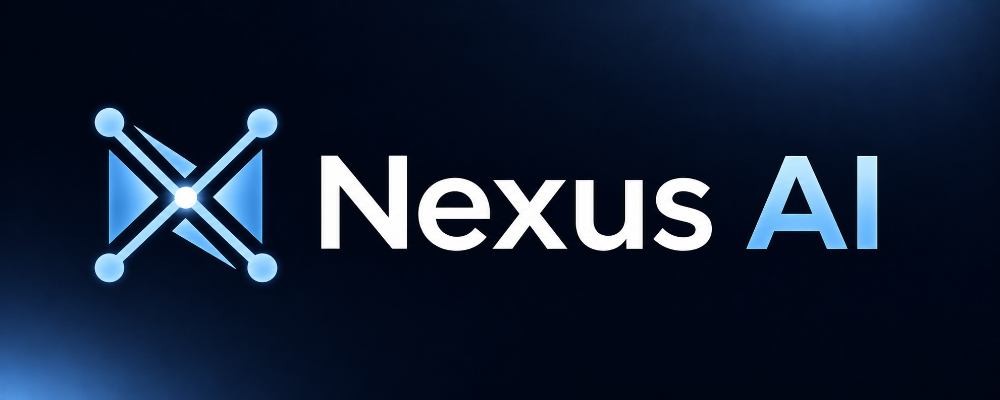
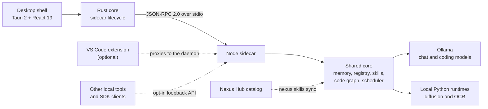
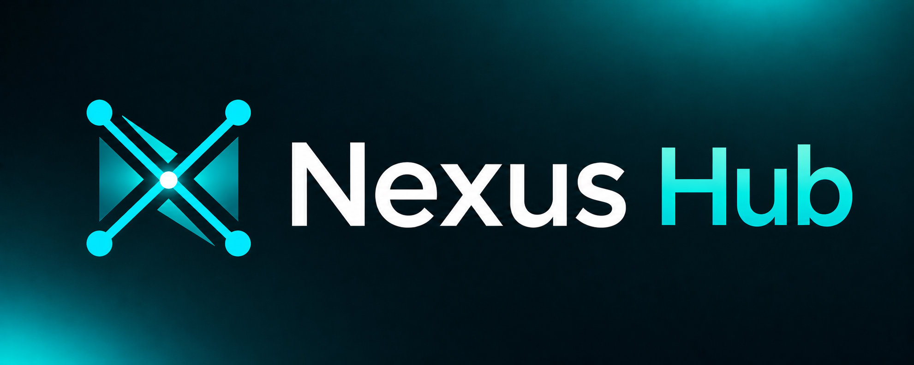
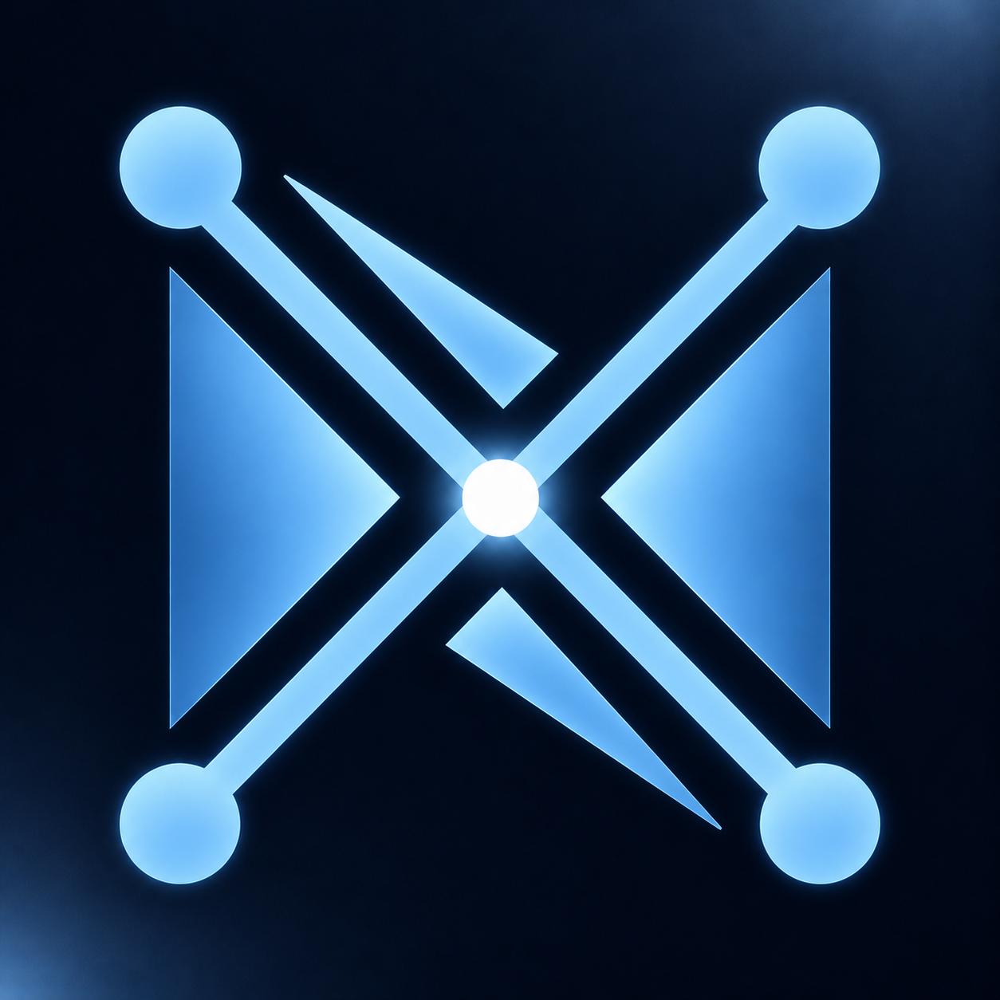
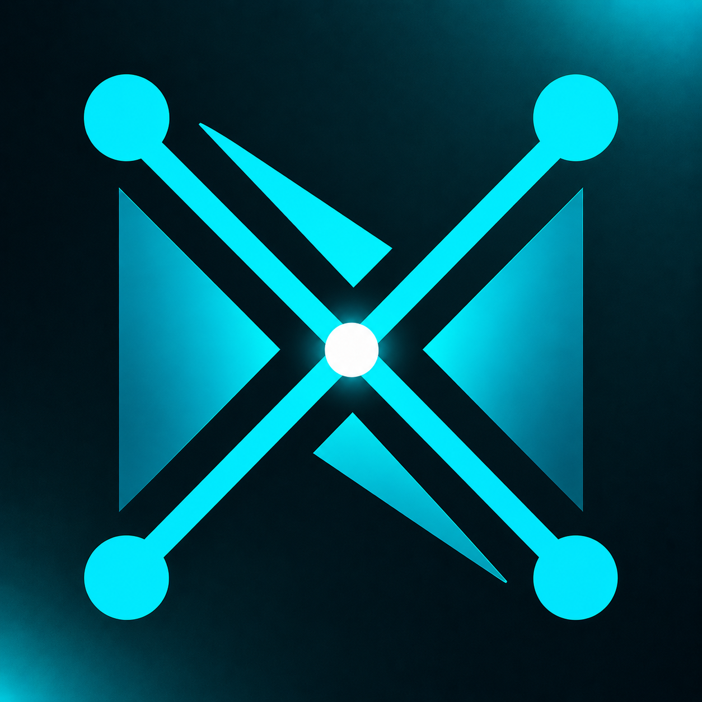

<p align="center"><a href="https://github.com/bendourthe/Nexus-AI"></a></p>

<p align="center"><em>Your Local AI Studio. Four Pillars, One Desktop, Zero Tokens Billed.</em></p>

# Nexus AI

Nexus AI Studio is a local-first desktop app for generative AI. It brings agentic coding, organized chat, image generation and editing, and short video synthesis into one window. Every model runs on your own machine through open-source runtimes, so there are no API keys, no per-token bills, and no data leaving the computer unless you turn on a feature that needs it.

**Platforms:** a one-file Windows installer for the full desktop app, plus an optional VS Code extension for Windows, macOS (Apple Silicon), and Linux.

[Download the latest release](https://github.com/bendourthe/Nexus-AI/releases/latest) | [Installation guide](docs/install.md) | [Interactive guide](guides/interactive-guide/nexus-ai-guide.html) | [Architecture](ARCHITECTURE.md) | [Release history](docs/reference/release-history.md)

> Nexus AI was called **Gemma Code** from v0.1.0 to v0.22.x, when it was a single-purpose coding extension for VS Code. At v1.0.0 that engine became the Agentic AI Coding pillar of the desktop app. The extension is still available as an optional surface.

## What's New in v2.16.1

- **CPU-only golden runs:** `nexus golden run` accepts a `num_gpu` option, and `0` qualifies a local model on the CPU alone. Model defaults do not change.
- **Cleaner command line:** the headless CLI exits on its own once pending work finishes, and production dependencies moved to Zod 4 without breaking MCP HTTP transport.
- **Safer releases:** a release is published only from a reviewed, annotated tag on `main`, and each Windows installer must pass a clean-machine install check before it ships.

[Release details](CHANGELOG.md#2161-2026-11-02) | [Earlier releases](docs/reference/release-history.md)

## Installation

All downloads are on the [latest release](https://github.com/bendourthe/Nexus-AI/releases/latest) page, with a `SHA256SUMS.txt` file to verify them.

| Platform | Download | What you get |
| --- | --- | --- |
| Windows 10/11 (x64) | `NexusSetup.exe` | The full desktop app, its runtimes, your chosen models, and the optional VS Code extension |
| Windows 10/11 (x64) | `nexus-coding-<version>-win32-x64.vsix` | The VS Code extension only |
| macOS 15+ (Apple Silicon) | `nexus-coding-<version>-darwin-arm64.vsix` | The VS Code extension only |
| Linux x86_64 (glibc 2.35+) | `nexus-coding-<version>-linux-x64.vsix` | The VS Code extension only |

**Windows desktop app**

1. Download `NexusSetup.exe`.
2. Run it. Windows shows a SmartScreen warning because the installer is not code-signed yet: select **More info**, then **Run anyway**.
3. Follow the wizard: hardware detection, install location, model selection (chat, coding, image, video), and the optional VS Code extension.
4. The wizard checks every download against a pinned SHA-256 checksum, installs the desktop app, and launches it. Run `NexusSetup.exe` again later to add models or repair components.

Plan for 5 to 60 GB of downloads, depending on the models you select. No administrator rights are needed, and user data lives in `~/.nexus`.

**VS Code extension (any platform)**

The extension requires Microsoft stable VS Code 1.134 through 1.137. Insiders, Cursor, and Windsurf are not supported. In VS Code, run **Extensions: Install from VSIX...** and select the file for your platform.

**Verify a download (Windows PowerShell)**

```powershell
(Get-FileHash .\NexusSetup.exe -Algorithm SHA256).Hash
```

The printed hash must match the `NexusSetup.exe` line in `SHA256SUMS.txt`. Headless installs, macOS and Linux details, and what the installer provisions are in the [installation guide](docs/install.md).

## The Four Pillars

### 1. Agentic AI Coding

An autonomous coding agent that reads local repositories, runs code in isolated environments, debugs, and implements features across many files.

- Inherits the full Gemma Code engine: tool registry, plan mode, four-layer memory, MCP support, skill catalog, and sub-agent dispatch.
- Picks only from agentic models that this install owns (selected in the installer or Settings), never leftover Ollama tags.
- Runs in the desktop app or in the optional `nexus-coding` VS Code extension, which proxies to the desktop daemon and falls back to an in-process engine.
- Optional, off by default: a local skill self-optimization loop (`nexus skills optimize`) and a per-model harness selector (`nexus.coding.harnessSelector.enabled`) that tunes the agent scaffold to each local model.

### 2. Local Chatbot Explorer

A chat interface organized like a file system. Chats live in nested folders, each project can keep its own context, and four memory layers (working, episodic, semantic, graph) keep long threads coherent.

- Hybrid retrieval combines BM25, dense vectors, and the memory graph through Reciprocal Rank Fusion (`k=60`).
- The `all-MiniLM-L6-v2` embedder is bundled by the installer, so retrieval never calls the Hugging Face Hub.
- Model pickers list only the models this install owns, in recommended order.

### 3. Image Studio

Text-to-image, image-to-image, inpainting, and outpainting on local diffusion pipelines tuned for one laptop GPU.

- SANA-1.6B is the default 1024 px model (about 2x faster than SDXL Turbo, Apache-2.0 weights), with Sana-Sprint as the "Fast Preview" tier.
- SANA 2K and 4K sit behind a `DiffusionTier` policy, alongside SANA-ControlNet and the Flow-DPM-Solver sampler.
- Edits are saved as a versioned recipe with undo and redo; the original image bytes never change.

### 4. Video Lab

Short video synthesis from a text prompt or a reference image, with a timeline preview and detailed generation controls.

- SANA-Video 2B is the "Fast 720p" tier between LTX-Video and CogVideoX.
- Optional enhancement can upscale or interpolate a finished clip through a Video2X 6.4.0 executable you install yourself (`NEXUS_VIDEO2X_PATH` or Settings > Video). Nexus never downloads or bundles Video2X.
- Real GPU and packaged-app support for enhancement is still a candidate until it is measured ([baseline](docs/archive/v2/v2.3/benchmarks/video-enhancement-baseline.md)).

### Document parsing (OCR)

Attach a PDF, image, Word, PowerPoint, or Excel file in Chat or Coding, and Nexus turns it into text on your machine.

- PDFs and images use **RapidOCR PP-OCRv4** (Apache-2.0, about 20 MB, CPU, every OS) or the optional **Unlimited-OCR 3B** (MIT, NVIDIA, layout-preserving Markdown).
- `.docx`, `.pptx`, and `.xlsx` files parse with native libraries and need no OCR model.
- OCR models are optional, never installed automatically, and pinned to a specific revision. Extracted text is shown to you and never sent to a model on its own.

### Local API server (opt-in)

Nexus can serve its installed models to other tools on the same computer. Turn on **Settings > Local API server** to get a loopback HTTP API compatible with OpenAI and Anthropic clients (`GET /v1/models`, `POST /v1/chat/completions`, `POST /v1/messages`, buffered or streamed). Claude Code, Codex, Cursor, and SDK clients can then use the models you already downloaded.

- Off by default. With both this server and the ACP agent off, no port is bound.
- Refuses any non-loopback address, and every request needs a locally generated bearer token.
- Serves model output only: never files, the terminal, or tools.
- A second toggle enables the **ACP agent** (`nexus.acp.enabled`, `POST /acp`, JSON-RPC 2.0) on the same listener and token. Each toggle is independent.

### Ask inbox and scheduled runs (opt-in)

Headless and scheduled agent runs no longer fail on the 60-second confirmation timeout. Consequential tool calls wait in the **Ask inbox** until you approve or deny them, and approval replays the normal permission gate.

- A local scheduler can start recurring runs. The built-in morning brief is off by default.
- Every run goes through the same permission tiers and Git checkpoint as an interactive run. There is no auto-approve path, and without an inbox a call fails closed.

### MLX on Apple Silicon (via local adapters)

Nexus does not bundle an MLX runtime. If you already run an OpenAI-compatible MLX server (mlx-vlm, LM Studio in MLX mode, or nativ), register it as a loopback `nexus.llm.localAdapters` manifest and select it with `nexus.llm.backend`. See the [MLX how-to](docs/archive/v1/v1.16/guides/mlx-via-local-adapters.md).

### llama.cpp on loopback (via local adapters)

Nexus does not bundle llama.cpp. If you already run `llama-server` on loopback (including large-MoE CPU-expert or mmap offload), register it as a `nexus.llm.localAdapters` manifest with `protocol: "openai"`. See the [llama.cpp recipe](docs/reference/llamacpp-loopback-adapter.md). This does not open the patient-tier gate.

### Always-on telemetry

A persistent **Local Model Status** panel shows the active model, its parameter size, live GPU use, and free VRAM, so heavy passes do not fail silently with out-of-memory errors. The same data feeds the GPU scheduler, which puts coding token generation ahead of background diffusion work when both need the GPU.

## How It Works



The desktop shell never talks to a model directly: the Node sidecar owns inference, memory, and tools, and the shared `core/` packages are reused by both the sidecar and the VS Code extension. Module boundaries are enforced in CI by [dependency-cruiser](configs/dependency-cruiser.cjs). Full detail is in [ARCHITECTURE.md](ARCHITECTURE.md).

## Featured Capabilities

Agent loop

| Capability | What it does |
| --- | --- |
| **Plan mode** | The `/plan` slash command writes a Markdown plan, then the agent works through each step. |
| **Auto mode** | End-to-end tool-using sessions with verification gates and Git checkpoints. |
| **Slash commands** | `/recall`, `/remember`, `/forget`, `/curate`, `/trace`, `/memory`, `/plan`, plus the skill-backed catalog with `preferUpstream` ordering. |
| **MCP support** | Stdio MCP servers join through the per-project registry. Search, embeddings, scraping, and generation as a service are banned, and per-tool deny rules only tighten that default. |
| **Per-model harness selection** | Tunes the agent scaffold for each local model with a golden A/B test. Opt-in (`nexus.coding.harnessSelector.enabled`). |
| **Ask inbox + scheduler** | A persistent local approval queue for headless and scheduled runs (`~/.nexus/ask-inbox.json`), with a desktop `/inbox` panel and pending badge. No auto-approve. |

Memory and skills

| Capability | What it does |
| --- | --- |
| **Four-layer memory** | Working, episodic, semantic, and graph layers with per-tier forgetting curves (24 h, 7 d, 30 d, 365 d) and a scope-aware retriever. |
| **Hybrid retrieval** | BM25, dense, and graph results merged by Reciprocal Rank Fusion (`k=60`), with a bundled local embedder. |
| **Skill harness** | The Nexus Hub catalog syncs into `~/.nexus-ai/catalog/` with `nexus skills sync`, hot-reloads on change, auto-syncs weekly, and passes an allowlist and prompt-injection scanner on every install. |
| **Skill self-optimization** | Local, human-approved edits to skills, graded on golden tasks and validated on held-out tasks (`nexus skills optimize` and `frontier`). Opt-in and off by default. |
| **Document parsing** | Optional RapidOCR (CPU) and Unlimited-OCR (NVIDIA) for PDFs and images; native DOCX, PPTX, and XLSX parsing without those models. |

Runtime and operations

| Capability | What it does |
| --- | --- |
| **GPU scheduler** | Puts coding token generation ahead of background diffusion work on a shared GPU; tier-aware (`diffusion-low`, `mid`, `high`). |
| **Local API server** | Opt-in loopback OpenAI- and Anthropic-compatible gateway (`nexus.serving.enabled`, off by default). ACP (`nexus.acp.enabled`) mounts `POST /acp` on the same listener and token. |
| **MLX via local adapters** | Register an mlx-vlm, LM Studio MLX, or nativ server on loopback as `nexus.llm.localAdapters` ([how-to](docs/archive/v1/v1.16/guides/mlx-via-local-adapters.md)). No bundled MLX runtime. |
| **llama.cpp via local adapters** | Register a user-started `llama-server` on loopback as `nexus.llm.localAdapters` ([recipe](docs/reference/llamacpp-loopback-adapter.md)). No bundled runtime. |
| **Session replay** | A timeline scrubber and a side-by-side compare view for two sessions in the trace dashboard. |
| **Trace dashboard** | Tool spans, hook filter, session list, replay scrubber, and side-by-side compare. |
| **Operation log** | An opt-in, append-only Markdown line per tool call; secret paths are redacted before writing. |
| **Motion identity** | Internal orbs, beam, and metal ring on the desktop shell, one primary motion per surface, and full respect for the OS reduced-motion setting. |

## Nexus AI and Nexus Hub

<p align="center">
  <a href="https://github.com/bendourthe/Nexus-AI"></a>
  &nbsp;&nbsp;
  <a href="https://github.com/bendourthe/Nexus-Hub"></a>
</p>

The two projects are two halves of one idea, split along a deliberate line: Nexus AI is the runtime, and Nexus Hub is the catalog.

| |  Nexus AI (this repository) |  Nexus Hub |
| --- | --- | --- |
| Role | Desktop AI studio: four pillars, local memory, retrieval, GPU scheduling, and the Windows installer | Harness for AI coding tools: skills, commands, rules, hooks, agents, and guardrails |
| Where it runs | Local open-source models on your machine | Inside Claude Code, Codex, GitHub Copilot, Cursor, Antigravity, and other agents |
| How they connect | Pulls the Hub catalog with `nexus skills sync` and scans every skill before it loads | Publishes the releases that Nexus AI syncs |
| Works alone | Yes, with or without the catalog | Yes, without Nexus AI |

Together they give every agent surface a developer uses (terminal, IDE, and desktop app) one curated skill set. See the [Nexus Hub repository](https://github.com/bendourthe/Nexus-Hub) for its install command and live catalog counts.

## Design Principles

1. **Local-first:** inference, embeddings, image and video synthesis, and memory all run on the host machine. Nothing goes out without your explicit opt-in.
2. **Original over wrappers:** when an external service or heavy framework can be rebuilt as a lean local module, it is. The only external project linked by design is [Nexus Hub](https://github.com/bendourthe/Nexus-Hub).
3. **One-GPU ceiling:** every pillar must run on a laptop with one consumer GPU (RTX 3070 to 4090 class). The installer detects the hardware tier and sizes context budgets, batch sizes, and pipeline depth to fit.
4. **The installer does the heavy lifting:** the Windows installer provisions runtimes, models, the desktop app, and the optional extension in one pass.
5. **Private by construction:** memory writes pass the [`redactSecrets`](core/observability/redactSecrets.ts) filter before indexing, and telemetry, traces, and logs stay local by default.
6. **Honest evidence:** a behavior not proven locally is written as "not proven here", and every capability claim states its support tier.

## Developer Quick Start

Prerequisites: Node 20+, Rust and Cargo (for the Tauri core), and Ollama for inference. On a fresh clone, run the bootstrap first: `pwsh scripts/init.ps1` on Windows or `bash scripts/init.sh` on macOS and Linux.

```bash
git clone https://github.com/bendourthe/Nexus-AI.git
cd Nexus-AI
npm ci                       # install root and desktop workspace dependencies
npm run build                # compile the shared core and Coding module
npm run test                 # run the vitest suite

npm run dev:shell            # open the Tauri window in dev mode (Vite HMR + sidecar)
npm run build:shell          # build a platform-native bundle
npm run lint:shell           # eslint with zero warnings on desktop/
npm run test:shell:coverage  # desktop tests with the 80% coverage gate
```

**Command line**

| Command | Purpose |
| --- | --- |
| `nexus skills sync [--tag <tag>] [--apply]` | Sync the Nexus Hub catalog into `~/.nexus-ai/catalog/` |
| `nexus skills list` / `install` / `remove` | Browse and manage installed skills |
| `nexus skills audit [--deep-logs] [--by-root]` | Read-only token-budget report on the skill catalog |
| `nexus skills optimize` / `frontier` | Run the local skill optimizer and view its candidate frontier |
| `nexus golden run` | Run golden tasks live against the headless agent |
| `nexus memory audit` / `export` / `import` / `decay --now` | Inspect, back up, restore, and age local memory |
| `nexus doctor [--migration-report] [--json]` | Read-only inventory of stale state; never changes disk |
| `nexus check ...` | Deterministic source checks (lint, hooks, skill validation) |

Every command group has a reference page under [docs/reference/cli/](docs/reference/cli/README.md).

## Repository Layout

```
core/        Shared packages used by the sidecar and the extension (memory, skills, registry, codegraph, storage, telemetry)
modules/     Per-pillar engine code; the agentic coding engine lives in modules/coding/
src/         VS Code extension host: activation, webview panels, tool handlers, storage, daemon adapter
desktop/     Tauri 2 desktop shell
  src/         Vite + React 19 + TypeScript frontend (four-pillar UI)
  src-tauri/   Rust core (sidecar lifecycle, ipc_call command)
  sidecar/     Node sidecar (esbuild bundle, JSON-RPC 2.0 over stdio)
scripts/     Build, packaging, installer (PyQt wizard in scripts/installer/), and utility scripts
tests/       Unit, integration, e2e, and benchmark suites
docs/        Releases, archives, guides, reference, runbooks, and decisions
assets/      Logos, banners, icons, and favicons
bin/         CLI entry points (nexus, nexus-check, nexus-image, nexus-video)
configs/     Linter, build, dependency-cruiser, and vitest configs
```

## Safety and Privacy

Inference, embeddings, memory, and image and video synthesis all run on the host machine. The MCP registry policy rejects search, embeddings, scraping, and generation offered as a service.

| Use case | Fit |
| --- | --- |
| Open-source, hobby, or internal commercial software | Green, no restrictions |
| Regulated industries (healthcare, finance, government, life sciences) | Green with caveats: Nexus is local-only, but review your chosen model weights and any MCP servers you add |
| Defense, classified, or air-gapped | Feasible once the installer payload is staged offline; do your own assessment |

**Off by default:** telemetry, analytics, phone-home, third-party data processors, model downloads at runtime, and API keys.

**Outside Nexus's control:** your model weights, any MCP server you add, outbound commands you start (`gh`, `git push`, `curl`), and your own hooks and rules. Code the agent runs through `run_terminal` executes with your user privileges behind tool-layer guardrails. An optional OS process sandbox (`nexus.coding.execSandbox`, off by default) adds Seatbelt, Landlock with seccomp, or a Windows job object; when it is off, the UI and logs say **unconfined**.

Read [SECURITY.md](SECURITY.md) for the full threat model. To report a vulnerability, email [benjamin.dourthe@gmail.com](mailto:benjamin.dourthe@gmail.com) or open a [private security advisory](https://github.com/bendourthe/Nexus-AI/security).

## Roadmap

Each item traces to a known-gaps entry and closes when its work merges and the next release is cut in [CHANGELOG.md](CHANGELOG.md). No star gates, no sponsor tiers, no paid features.

| Focus | Status | Source |
| --- | --- | --- |
| OS process sandbox for agent code; Windows filesystem and network enforcement remain partial | Landed in v1.18.0; Windows remainder tracked | [v1.18 gaps](docs/archive/v1/v1.18/known-gaps.md) (`EM.P5.A`, `DF-11`) |
| Extreme-low-bit (BitNet-class) and disk-offload "patient" models, once runtimes and independent benchmarks confirm them | Gated | [v1.12 gaps](docs/archive/v1/v1.12/known-gaps.md) (`EM.P3`, `EM.P4.A`) |
| Harness selector on by default for weak models, after a measured A/B win | Gated | [v1.12 gaps](docs/archive/v1/v1.12/known-gaps.md) (`EM.P1`) |
| Skill optimizer on by default, after a measured A/B win | Gated | [v1.7 gaps](docs/archive/v1/v1.7/known-gaps.md) (`SO003.P3.A`) |
| Clean-machine installer rehearsals and on-device visual QA on three operating systems | Tracked | [v1.11 gaps](docs/archive/v1/v1.11/known-gaps.md) (`IO.P2.A`) |

Current open work is in the [v2.17 known gaps](docs/releases/v2/v2.17/known-gaps.md) and the [progress tracker](docs/todos.md).

## Documentation

- [Installation guide](docs/install.md) and [interactive guide](guides/interactive-guide/nexus-ai-guide.html)
- [Architecture](ARCHITECTURE.md) and [agent directive](AGENTS.md)
- [Release history](docs/reference/release-history.md), [changelog](CHANGELOG.md), and [development log](docs/DEVLOG.md)
- [Model acceptance bar](docs/reference/model-acceptance.md) and [declined models](docs/reference/declined-models.md)
- [Feature inventory contract](docs/reference/feature-inventory.md)
- [Security policy](SECURITY.md)
- [Contributing](CONTRIBUTING.md) and [first-time contributors](CONTRIBUTING-BEGINNERS.md)

## Collaboration

Nexus AI is a curated open-source project. Outside pull requests are usually not accepted, but suggestions, feedback, and use cases are welcome, especially when they fit the project's direction (local-first, rebuild-over-wrap, no third-party data leaks).

- **Email:** [benjamin.dourthe@gmail.com](mailto:benjamin.dourthe@gmail.com)
- **GitHub:** [@bendourthe](https://github.com/bendourthe)

## License

[MIT](LICENSE). Maintained by [Benjamin Dourthe](https://www.benjamindourthe.com/).
